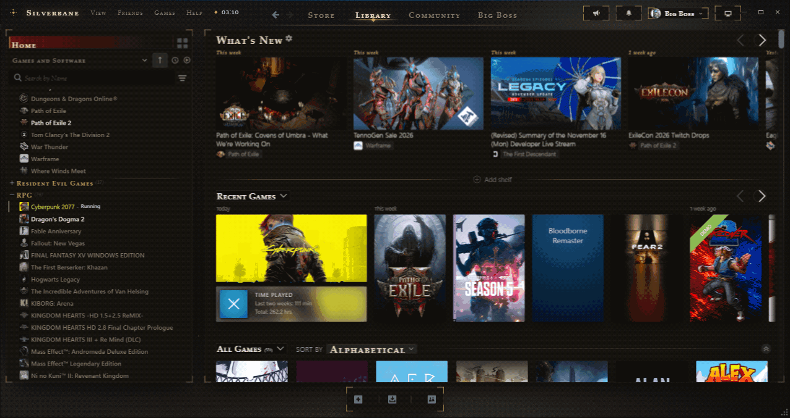
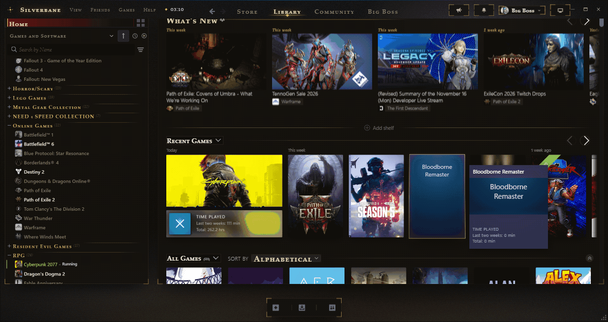
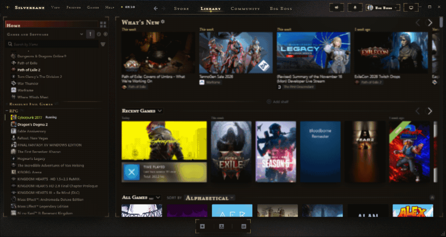
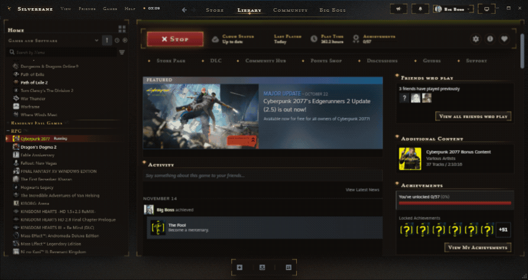

# Silverbane

**A dark-fantasy grimoire for the Steam client.** A [Millennium](https://steambrew.app) theme.

Silverbane turns Steam into the pages of an old tome read by candlelight. Gilt-cornered
pages float over a night of drifting fog and rising embers. Headings are set in
engraved serif small caps, and the Play button is a blood-red seal with a sigil that
turns behind it when you reach for it.

## Highlights

| | |
|---|---|
| **A living night** | A cold moon glow over warm black, banks of fog drifting across the bottom of the window, embers rising from below, parchment grain and a heavy candlelit vignette. |
| **Gilded pages** | Panels, buttons, menus and notifications carry gold corner brackets. Rules fade out at both ends, and gold diamonds mark what is active. |
| **Engraved type** | Serif small caps for menus, tabs, headings and labels (Palatino Linotype, which ships with Windows). |
| **Navigator** | Store / Library / Community as engraved words; a gold diamond and rule glide to the page you are on. |
| **Game list** | Collections headed in gold small caps; the selected game gets a blood-red wash and a glowing gold diamond. |
| **Covers** | 3D tilt toward the cursor with candlelight and a gilt rim. |
| **Game page** | The title art fades in like ink. The Play seal breathes with ember light, and a gold sigil turns behind it on hover. Progress bars fill with molten gold. |
| **The hour** | The time and the hour of the day ("dawn", "dusk", "nightfall"...) beside the menus. |
| **Prologue** | A title page with a turning sigil and a short epigraph when the Steam window opens. It can be turned off. |
| **Everywhere** | Context menus, notifications arriving as sealed letters, the sign-in sigil, settings, friends and chat, and the Store and Community pages. |

## Prologue

## Palettes

**Silver** (silver, old gold, dried blood), **Ember**, **Frost**, **Grove** and **Bloodmoon**.
Pick **Custom** to use your own four colors from the theme's Colors page.

## Options

Open **Millennium → Themes → Silverbane** to change any of these:

- **Look:** Palette · Night (Living / Still / Moonless) · Fog · Embers (Few / Many / None) · Gilded frames · Corner radius · Page opacity · Page blur
- **Layout:** Framed or Seamless pages · Navigator position · Game list density · What's New shelf · Dock labels · Hour of the day
- **Motion:** Prologue · Motion (Full / Calm / Still) · Cover hover (Tilt / Lift / Off) · Cursor light
- **Extras:** Privacy blur on your account name and wallet

Silverbane honors Windows' *reduce motion* setting, and **Motion → Still** turns off every
animation the theme adds. There is no flashing: the candle flicker only varies brightness
by a few percent.

## Install

1. Install [Millennium](https://steambrew.app).
2. Install Silverbane from the [theme gallery](https://steambrew.app/themes), or clone this repo into
   `Steam/millennium/themes/Silverbane`.
3. In Steam, open **Millennium → Themes** and select **Silverbane**.

## Notes

- Fonts: Palatino Linotype and Segoe UI. Both ship with Windows, so the theme loads nothing remote.
- Silverbane is an original dark-fantasy design. It is not affiliated with Valve or with any game
  or book series, and it uses no game's name, logo, fonts or artwork.
- Steam updates sometimes rename the client's internal classes. If something looks off after a
  Steam update, please open an issue.

## Changelog

### 1.0.0
- First release.

## License

[MIT](LICENSE)
